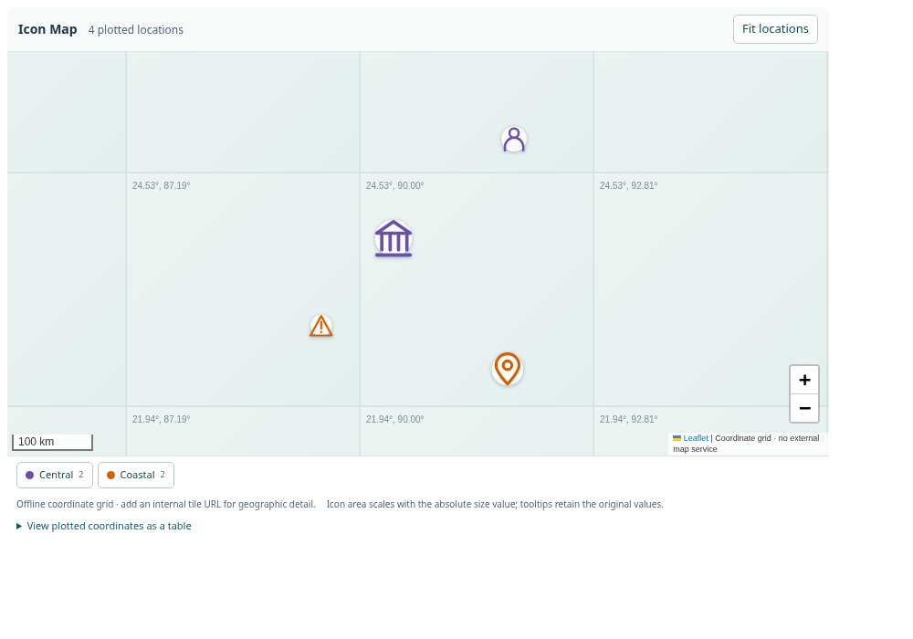

# BURO Icon Map for Apache Superset 4.1.2

An original Apache-2.0 chart plugin. This adds **BURO Icon Map** to Superset's chart picker, with chart key `buro_icon_map`. It does not copy or require Power BI or a paid Icon Map product.



## Use in Superset

1. Build and install the image described in [the deployment guide](../../deploy/superset/ICON_MAP.md).
2. Register an authorized SQL dataset containing decimal latitude and longitude columns.
3. Create a chart, choose **BURO Icon Map**, and select latitude and longitude under **Location data**.
4. Optionally select a location label, category/color, numeric size, icon column and tooltip fields. Apply filters, run the chart, and save it to a dashboard.

Supported icon names: `pin`, `branch`, `person`, `warning`, `circle`, `square`, `diamond`, `triangle`. Unknown names use the default icon. Marker area scales with the absolute size; the popup preserves the original signed value. Missing size values use the minimum size.

The default map is an **offline coordinate grid**, without streets or land boundaries. An approved internal XYZ tile service can provide geographic detail; configure its URL with `{z}`, `{x}` and `{y}` and its required attribution. A configured tile service receives viewport tile requests. No public tiles, geocoding or external image icons are enabled by default.

Coordinates must be within ±180° longitude and ±85.0511° latitude. Branch codes alone cannot be mapped; join an authorized coordinate lookup in the dataset first. At most 5,000 rows are queried/displayed (default 1,000); invalid locations are counted and excluded. Labels are limited to 200 visible points and the accessible table to 100. Legend buttons locally hide/show the first 12 categories; they do not change dataset access rules. This release does not implement route lines, region shading, automatic geocoding or cross-chart filter events.

## Agent use later

The chart runs inside Superset independently of the agentic application. An agent with appropriately scoped Superset credentials can later create a chart using the existing chart API and `viz_type: "buro_icon_map"`. See [example form data](examples/form-data.json); replace the dataset ID and columns with authorized values. Normal Superset database, dataset and dashboard permissions still apply. The existing agent snapshot publisher is not changed to create maps automatically.

## Development checks

```bash
npm ci --cache /tmp/buro-icon-map-npm
npm test
npm run typecheck:ui
```

The isolated tests cover the renderer and query behavior. The image build additionally compiles the plugin within the pinned Superset frontend. See `THIRD_PARTY_NOTICES.md` for dependency notices.
